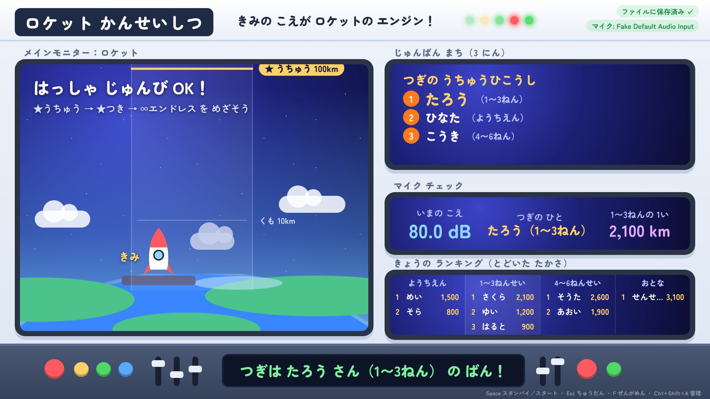
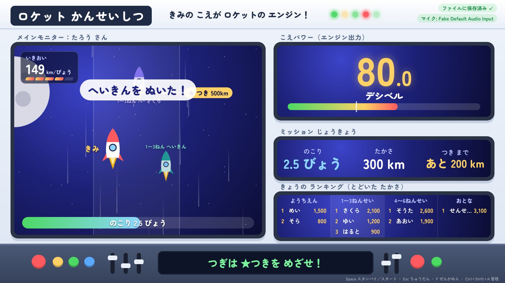
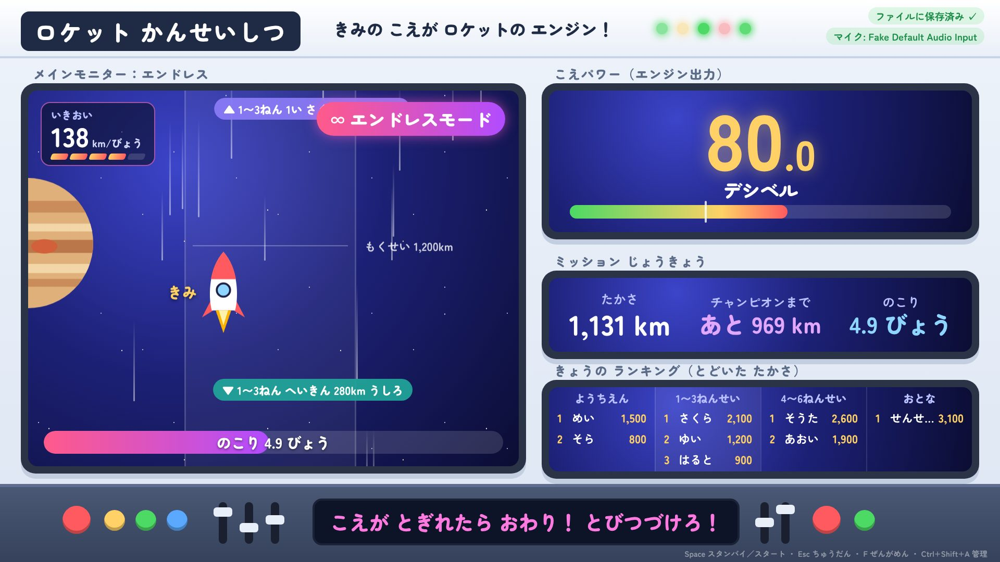
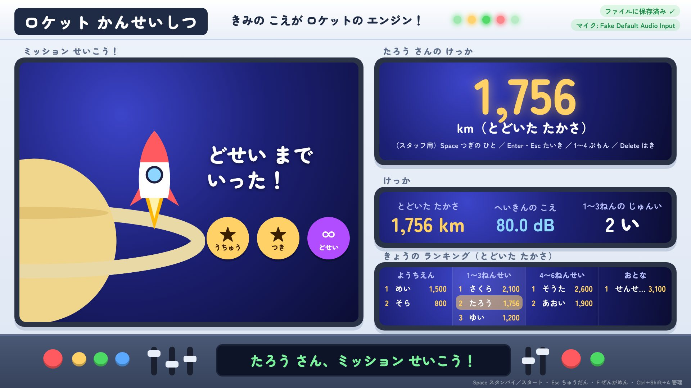
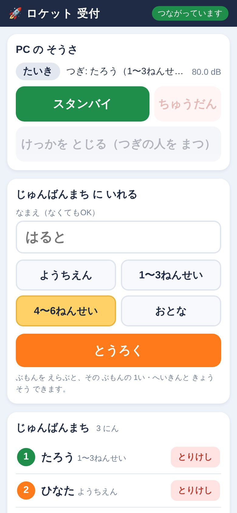
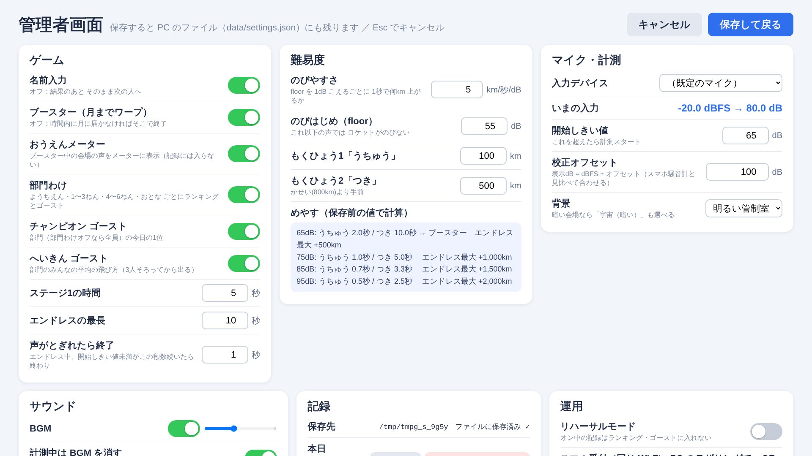

# ロケット かんせいしつ — つかいかたガイド（企画メンバー向け）

> 北の見本市 の「声の大きさ」コーナー用ゲームです。
> このページは **はじめて見る人向け** のまとめです。細かい設定は [README](../README.md)、当日のトラブル対応は [TROUBLESHOOTING](TROUBLESHOOTING.md) を見てください。
> 画面写真の名前・記録はすべて説明用の架空のものです。



## これは何？

マイクに向かって声を出し続けると、**声の大きさ（dB）に応じてロケットが宇宙へ上がっていく**ゲームです。
プロジェクターに映して、並んでいる子や見ている人も一緒に盛り上がれるようにしています。

- 部門は **ようちえん / 1〜3ねんせい / 4〜6ねんせい / おとな** の 4 つ。部門ごとにランキングが出ます。
- 同じ部門の **きょうの 1 位（チャンピオン）** と **みんなの へいきん** が「ゴースト」として一緒に飛ぶので、その場で競争できます。
- 声が小さい子でも最後は必ず月まで行ける（ブースター）ので、「とどかなかった…」で終わらないようにしています。

## あそびかた（子どもから見た流れ）

| | |
|---|---|
| **1. とぶ**<br>スタッフの「せーの！」で声を出すと発射。5 秒間、声が大きいほど速く上がる。<br>左上に いきおい（km/びょう）、右にゴースト（紫＝チャンピオン、緑＝へいきん）。 |  |
| **2. エンドレス**<br>月にとどいたら（とどかなければブースターで月までワープ）∞ エンドレスへ。声がとぎれるまで、火星・木星…と最長 10 秒のびる。 |  |
| **3. けっか**<br>とどいた高さ・場所・バッジ・部門内の順位が出る。1 位を超えたら「しんきろく」演出。 |  |

1 人あたり **だいたい 30 秒〜1 分**（受付・説明・飛行・結果を含む）。

## 当日の流れ（スタッフ側）

```
 [並んでいる子]          [スマホ受付係]              [PC係]                    [プロジェクター]
  名前・学年を聞く  →  スマホで「とうろく」  →  画面に「つぎは ○○さん」
                                               Space（スタンバイ）     →  「こえを だして！」
  マイクの前へ     ←──────────────────────────  声を出したら自動で発射  →  ロケットが飛ぶ
                                               結果が出る              →  順位・しんきろく
                                               Space で次の子へ
```

- **スマホ受付**: 名前と部門を先に登録しておくと、PC で名前を打つ必要がありません（結果画面の名前入力もとばします）。
  スマホからも スタンバイ / ちゅうだん / けっかを とじる が押せるので、**PC 係がいなくてもスマホ 1 台で回せます**。
- **名前なしでも遊べます**（その場合は結果画面で名前を入れるか、そのまま次へ）。
- 失敗したとき（マイクに近すぎた、合図の前に声が出た等）は **Esc（スマホなら ちゅうだん）** で、記録を残さずやり直せます。

<p align="center"></p>

## 役割と人数（案）

| 役割 | 人数 | やること |
|---|---|---|
| PC 係 | 1 | Space で呼び出し、トラブル時の対応。スマホ操作でまかなえるなら受付係と兼任も可 |
| スマホ受付係 | 1 | 列の子の名前・部門を登録、順番の案内 |
| マイク・誘導係 | 1 | マイクの前に立たせる、「せーの！」の合図、盛り上げ |

最低 1 人（スマホで全部やる）でも動きますが、混む時間帯は 2〜3 人いると安心です。

## 必要な機材

| 機材 | メモ |
|---|---|
| Windows PC | Chrome か Edge が入っていればよい。Python があるとスマホ受付が使える（無くても PC だけで遊べる） |
| マイク | DJI Mic Mini（予定）。スタンドで口との距離を一定にすると記録が公平になる |
| プロジェクター＋HDMI ケーブル | 1920×1080 に合わせた画面。暗い会場用に「宇宙（暗い）」背景もある |
| スピーカー | BGM・効果音用。**マイクから離して置く**（音を拾うと dB が上がるため。飛行中は BGM は自動で消える） |
| スマホ | スマホ受付・操作用。PC と同じ Wi-Fi か、PC のモバイル ホットスポットにつなぐ（インターネット不要） |
| 延長コード・充電器 | PC・プロジェクター・スマホ用 |

## 準備のしかた（前日〜開場前）

1. PC にアプリのフォルダを置く（GitHub の「Code → Download ZIP」でも可）。BGM を使うなら `sound/` フォルダに音源を入れる（音源は Git に入っていません）。
2. `start.bat` をダブルクリック → 黒いウィンドウのチェックがすべて `[OK]` → ブラウザが開く。
   - 初回だけ「マイクの許可」と、Windows の「ファイアウォールの確認」（プライベート ネットワークで許可）が出ます。
3. 右上に「ファイルに保存済み ✓」と「マイク: （デバイス名）」が緑で出ていれば準備完了。`F` で全画面。
4. **Ctrl+Shift+A**（暗証番号 初期値 `0000`、当日までに変更推奨）で管理者画面を開き、
   - マイク・計測: 入力デバイスがマイクになっているか、いまの入力が声に反応するか
   - 難易度: 何人か試してみて、普通の大声で「月にとどくか、とどかないか」くらいに調整
   - 運用: **リハーサルモード** をオンにして練習 → 終わったらオフにして「本日の記録をリセット」
   - 運用: スマホ受付の QR コードをスマホで読む
5. スマホで「つながっています」になれば OK。



## みんなで決めておきたいこと

- [ ] **部門わけ** はこの 4 つでよいか（ようちえん / 1〜3 / 4〜6 / おとな）
- [ ] **難易度**: 会場の広さ・マイクで変わるので、当日の朝に試して決める担当者
- [ ] **ネットワーク**: 会場 Wi-Fi を使うか、PC のホットスポットにするか
- [ ] **BGM** を流すか（流すなら音源の用意と、スピーカーの位置）
- [ ] **ランキングの使い方**: 表彰するか、景品を出すか、最後に発表するか（記録は CSV で出せます）
- [ ] 誰が何時に何の係をやるか

## 困ったとき

→ [TROUBLESHOOTING.md（トラブルとりせつ）](TROUBLESHOOTING.md) に「症状 → まずやること」でまとめています。
よくあるもの: マイクが反応しない / 音が出ない / スマホがつながらない / 画面が固まった / 記録を消してしまった。

基本は **「`start.bat` をもう一度実行すれば、記録と設定はファイルから戻る」** です。

## 現状とお願い

- 動作テストは自動テスト（シナリオ 23 本）と本番用 PC での確認まで済んでいます。
- **難易度と開始しきい値は仮の値** です。本番のマイク（DJI Mic Mini）と会場で試してから決めます。
- 気づいたこと・やってほしいことがあれば、担当（デシベル係）まで。
